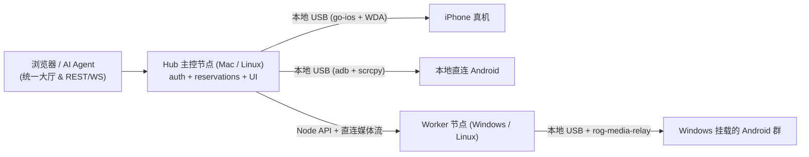

# 架构设计与双端合并路线图（uni-mobile-hub）

本文档说明如何将 `zhoujun94511/WebAppFlaskauto-iOS`（iOS 底座）与 `zhoujun94511/WebAppFlaskscrcpy`（Android/Scrcpy 引擎）合并为一套统一的 **Android + iOS 云真机与 AI 视觉控制平台**，并原生支持 **Hub + Worker 跨机节点协同**（如 Mac Studio 接 iPhone + Windows 宿主机接多台 Android）。

---

## 一、核心拓扑（Hub + Worker 主从协同）

为了避免“经 Tailscale/LAN 远端代理 `adb` 再重编码 `scrcpy`”带来的延迟与画质损失，同一套代码可同时扮演两种角色：

- **单机模式**：在一台 Mac/Windows/Linux 上同时开启 `ANDROID_ENABLED=1` 与 `IOS_ENABLED=1`，USB 直连机器即可统一管理。
- **Hub + Worker 跨机模式**：
  - **Worker（如 Windows）** 开启 `ANDROID_ENABLED=1`、`NODE_TOKEN=...`，继续利用本地 `scrcpy` + `rog-media-relay.exe` 提供极低延迟 H.264/WebRTC 视频流；
  - **Hub（如 Mac）** 开启 `IOS_ENABLED=1` 并配置 `REMOTE_NODES`，在统一设备大厅中混排展示所有设备；控制请求与媒体信令直达设备所在节点。

---

## 二、四阶段合并规划

### Phase 1：Backend Adapter Registry & 跨机节点聚合
- 在 `services/` 下抽象统一的 `DeviceAdapter` 接口（`discover` / `connect` / `disconnect` / `control` / `stream_info` / `screenshot` / `apps` / `files` / `logs`）。
- 保留现有 `IOSAdapter` 作为 iOS 引擎；新增：
  - `AndroidAdapter`：整合 `WebAppFlaskscrcpy` 的 `scrcpy/` 协议栈与 `adb` 服务；
  - `RemoteNodeAdapter`：拉取并代理远端 Worker 节点上的设备注册、抢占与控制。
- 设备对象统一携带 `platform`（`"android"` / `"ios"`）与 `node_id` 字段。

### Phase 2：前端双引擎视频播放器融合
- 外层统一共用 `DeviceStage.vue`（手机壳、分辨率/方向自适应、`0.0~1.0` 归一化触控坐标映射与防抖手势）。
- 内部 `DeviceScreen.vue` 根据 `device.platform` 动态挂载播放器：
  - `platform === "android"` -> `<AndroidScrcpyPlayer>`（WebRTC / MSE / `rog-media-relay` 低延迟 H.264 流）
  - `platform === "ios"` -> `<IosStreamPlayer>`（WebRTC / Socket.IO MJPEG / HEVC 帧流）

### Phase 3：面板能力差异化适配
- **公共能力**：账号鉴权、设备抢占锁、应用管理（`.apk` / `.ipa`）、文件浏览器、实时日志（`logcat` / `syslog`）。
- **平台特有导航与快捷操作**：
  - Android：返回、Home、多任务、电源、音量、ADBKeyBoard / 剪贴板粘贴输入；
  - iOS：Home、锁屏、AssistiveTouch、截图/WDA 会话重连。

### Phase 4：跨系统群控同步与 AI Agent 原生接口
- 移植 `WebAppFlaskscrcpy` 的群控同步（Sync），支持主控设备的点击/滑动按比例坐标（`0.0~1.0`）跨屏分发到选中设备（兼容 Android + iPhone 混控）。
- 提供标准化 Agent HTTP API（`/api/agent/devices`、`/api/agent/devices/:id/screenshot`、`/api/agent/devices/:id/tap` 等），配合纯视觉自动化工作流直接驱动任意平台真机。
